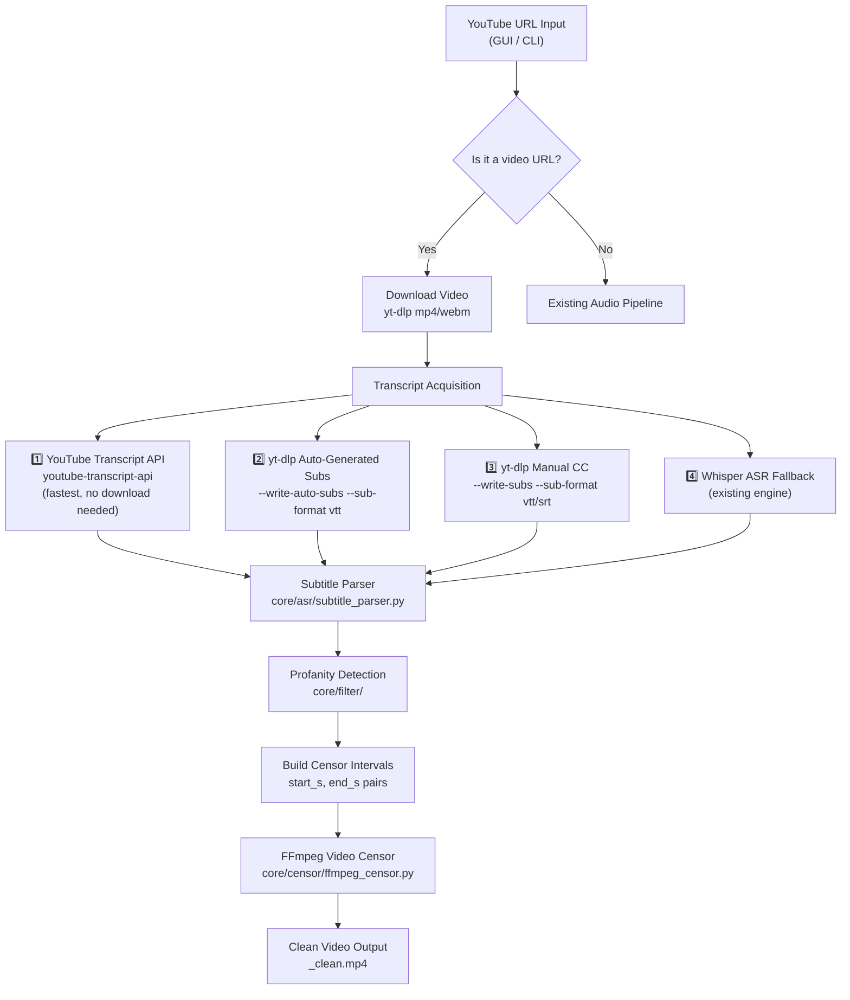

# 🎬 PLAN: YouTube Video Censor Mode

> **Status:** Planning Phase — No implementation yet  
> **Feature:** Extend the cuss-censor pipeline to process full YouTube **videos** (not just audio), detecting and censoring profanity directly in the video file.

---

## 1. Overview

Currently the pipeline handles **audio tracks** extracted from YouTube or music platforms. The new "YouTube Video Censor Mode" will:

1. Accept a YouTube video URL as input
2. Download the video (audio + video stream)
3. Obtain a timed transcript via multiple fallback strategies
4. Detect profanity in the transcript
5. Apply FFmpeg audio censorship (beep/mute) **on the video file** — producing a clean `.mp4` output
6. (Stretch) Optionally overlay a visual censor bar or blur on the speaker's face/mouth during censored segments

---

## 2. Architecture



---

## 3. Transcript Acquisition Strategy (Priority Order)

### Strategy 1 — YouTube Transcript API ⭐ (Recommended Primary)

**Library:** `youtube-transcript-api`  
**Install:** `pip install youtube-transcript-api`

```python
from youtube_transcript_api import YouTubeTranscriptApi

transcript = YouTubeTranscriptApi.get_transcript(video_id, languages=['hi', 'en', 'hi-IN'])
# Returns: [{'text': '...', 'start': 12.34, 'duration': 1.5}, ...]
```

**Pros:**
- No video download required for transcript fetch — instant
- Supports auto-generated **and** manually created captions
- Returns `start` + `duration` per segment — directly usable as censor intervals
- Works for Hindi (`hi`, `hi-IN`) and English (`en`)

**Cons:**
- Requires the video to have captions (auto or manual); fails silently on captionless videos
- Rate-limited by YouTube; may need proxy support for bulk processing

---

### Strategy 2 — yt-dlp Auto-Generated Subtitles

```bash
yt-dlp --write-auto-subs --sub-format vtt --sub-langs hi,en,hi-IN --skip-download <url>
```

**Output:** `<video_title>.hi.vtt` or `<video_title>.en.vtt`

**Pros:**
- Available on virtually all YouTube videos (YouTube auto-generates for most)
- VTT format often has **word-level timestamps** (especially English)
- No third-party API call

**Cons:**
- Requires spawning a subprocess
- VTT files need parsing (see Section 5)

---

### Strategy 3 — yt-dlp Manual CC / Subtitles

```bash
yt-dlp --write-subs --sub-format vtt --sub-langs hi,en --skip-download <url>
```

More accurate than auto-generated but only available when uploader provides captions.

---

### Strategy 4 — Whisper ASR Fallback (Already Implemented)

If no subtitles exist, fall back to the existing `WhisperEngine` on the extracted audio. Slower but universal.

---

## 4. New Module: `core/asr/subtitle_parser.py`

Parse VTT/SRT/JSON transcript data into a standard list of `LyricLine` objects (or a new `TranscriptSegment` dataclass).

### `TranscriptSegment` dataclass

```python
@dataclass
class TranscriptSegment:
    text: str
    start: float   # seconds
    end: float     # seconds
```

### Parser targets

| Format | Source | Parser method |
|--------|--------|--------------|
| YouTube Transcript API JSON | Strategy 1 | `parse_yt_transcript_api(data)` |
| WebVTT (`.vtt`) | Strategy 2 & 3 | `parse_vtt(filepath)` |
| SRT (`.srt`) | Strategy 3 | `parse_srt(filepath)` |
| Whisper output | Strategy 4 | Already implemented in `WhisperEngine` |

**Key library:** Python's `webvtt-py` (`pip install webvtt-py`) for VTT, or a lightweight regex parser to avoid extra deps.

---

## 5. Video Download Changes (`downloader.py`)

Add a new `download_video()` function (or a `mode='video'` flag to the existing `download_audio()`):

```python
def download_video(url: str, output_dir: str) -> str:
    """Download best quality video+audio as mp4. Returns local filepath."""
    ydl_opts = {
        'format': 'bestvideo[ext=mp4]+bestaudio[ext=m4a]/best[ext=mp4]/best',
        'outtmpl': os.path.join(output_dir, '%(title)s.%(ext)s'),
        'merge_output_format': 'mp4',
    }
    with yt_dlp.YoutubeDL(ydl_opts) as ydl:
        info = ydl.extract_info(url, download=True)
        return ydl.prepare_filename(info)
```

---

## 6. FFmpeg Censor Extension (`core/censor/ffmpeg_censor.py`)

The current `FFmpegCensor` already handles audio files. Extend it to handle video input/output:

### Current (audio only)
```
ffmpeg -i input.mp3 [audio filters] output_clean.mp3
```

### Extended (video)
```
ffmpeg -i input.mp4 [audio filter complex: beep/mute at intervals] -c:v copy output_clean.mp4
```

Key change: add `-c:v copy` to **pass through the video stream unchanged** — only the audio track is re-encoded with the censor overlay. This keeps processing fast.

### Proposed changes to `FFmpegCensor`:
- Detect input file type (audio vs. video) by extension or MIME
- If video: append `-c:v copy` and set output extension to `.mp4`
- If audio: existing behavior unchanged

---

## 7. CLI Integration (`censor.py` / `ui/cli.py`)

Add a new `video` subcommand:

```bash
# Censor a YouTube video by URL
python censor.py video --url "https://youtu.be/xxxxx" --output ./censored_output

# Censor a local video file
python censor.py video --file ./my_video.mp4

# Choose censorship style
python censor.py video --url "https://youtu.be/xxxxx" --mode beep   # default
python censor.py video --url "https://youtu.be/xxxxx" --mode mute
```

---

## 8. GUI Integration (`ui/gui.py`)

Add a **"YouTube Video"** tab (using `CTkTabview`) alongside the existing single-song and playlist tabs:

### Tab layout
```
┌─────────────────────────────────────────────────┐
│  🎬 YouTube Video Censor                        │
├─────────────────────────────────────────────────┤
│  YouTube URL: [_______________________________] │
│                                                 │
│  Transcript Source:  ○ Auto  ○ Manual CC  ○ AI  │
│  Censor Mode:        ○ Beep  ○ Mute             │
│  Output Folder:      [Browse...]                │
│                                                 │
│        [ 🎬 Process Video ]                     │
│                                                 │
│  Progress: ████████░░ 80%                       │
│  Log: [                                       ] │
└─────────────────────────────────────────────────┘
```

---

## 9. Implementation Phases

| Phase | Task | Files Affected | Priority |
|-------|------|---------------|----------|
| **0** | Add `youtube-transcript-api` and `webvtt-py` to `requirements.txt` | `requirements.txt` | 🔴 High |
| **1** | `subtitle_parser.py` — parse VTT, SRT, YT Transcript API JSON | `core/asr/subtitle_parser.py` *(new)* | 🔴 High |
| **2** | `downloader.py` — add `download_video()` with mp4 merge | `downloader.py` | 🔴 High |
| **3** | `ffmpeg_censor.py` — extend for video I/O with `-c:v copy` | `core/censor/ffmpeg_censor.py` | 🔴 High |
| **4** | `modes/video_mode.py` — orchestrate full video censor pipeline | `modes/video_mode.py` *(new)* | 🔴 High |
| **5** | CLI — add `video` subcommand | `censor.py`, `ui/cli.py` | 🟡 Medium |
| **6** | GUI — add "YouTube Video" tab | `ui/gui.py` | 🟡 Medium |
| **7** | Proxy/rate-limit handling for `youtube-transcript-api` | `core/asr/subtitle_parser.py` | 🟢 Low |
| **8** | *(Stretch)* Visual censor overlay (blur/black bar via FFmpeg `drawbox`) | `core/censor/ffmpeg_censor.py` | 🟢 Stretch |

---

## 10. New File Structure

```
cuss-censor/
├── core/
│   ├── asr/
│   │   ├── lyrics_provider.py          (existing)
│   │   ├── whisper_engine.py           (existing)
│   │   └── subtitle_parser.py          ✨ NEW — VTT/SRT/YT-API parser
│   └── censor/
│       └── ffmpeg_censor.py            🔧 EXTENDED — video I/O support
├── modes/
│   ├── single_song_mode.py             (existing)
│   ├── playlist_mode.py                (existing)
│   └── video_mode.py                   ✨ NEW — YouTube video pipeline
├── ui/
│   ├── gui.py                          🔧 EXTENDED — new Video tab
│   └── cli.py                          🔧 EXTENDED — `video` subcommand
├── downloader.py                       🔧 EXTENDED — download_video()
├── requirements.txt                    🔧 UPDATED — new deps
└── PLAN.md                             📋 This file
```

---

## 11. New Dependencies

Add to `requirements.txt`:

```
youtube-transcript-api>=0.6.2
webvtt-py>=0.4.6
```

No breaking changes to existing dependencies.

---

## 12. Stretch Goals

### 12.1 Visual Censor Overlay (FFmpeg `drawbox`)
Draw a black rectangle over the lower-third or full frame during censored segments:

```bash
ffmpeg -i input.mp4 \
  -vf "drawbox=x=0:y=ih-100:w=iw:h=100:color=black:t=fill:enable='between(t,12.5,13.2)'" \
  -af "volume=enable='between(t,12.5,13.2)':volume=0" \
  output_clean.mp4
```

### 12.2 Face/Mouth Blur (OpenCV + MediaPipe)
Detect the speaker's face and blur only the mouth region during profanity segments. Requires:
- `opencv-python`
- `mediapipe`

This is significantly more complex but would produce a "broadcast TV"-style censor effect.

### 12.3 Batch YouTube Playlist Video Censor
Extend the existing playlist mode to download full video files and apply video censoring across an entire playlist.

---

## 13. Key Risks & Mitigations

| Risk | Mitigation |
|------|-----------|
| YouTube blocks `youtube-transcript-api` (rate limit / bot detection) | Fall back to yt-dlp subtitle download; optionally support proxy config |
| Hindi video has no captions (auto or manual) | Whisper ASR fallback (already implemented) |
| Large video files (1GB+) slow to process | Process audio separately; use `-c:v copy` to skip video re-encode |
| VTT timestamps not word-level (only sentence-level) | Expand censor interval by ±0.3s buffer (same as current audio pipeline) |
| FFmpeg not in PATH on some systems | Already handled by existing `ffmpeg_censor.py` |

---

*Last updated: 2026-10-28*
