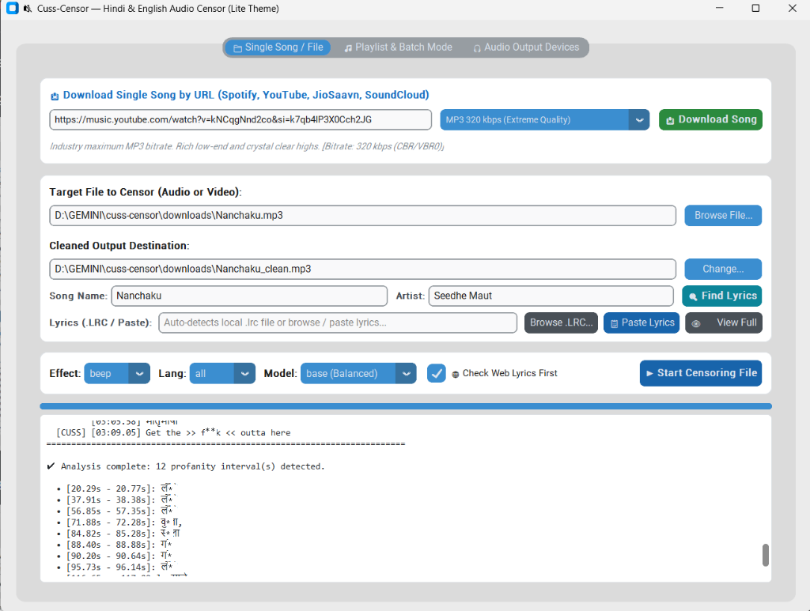
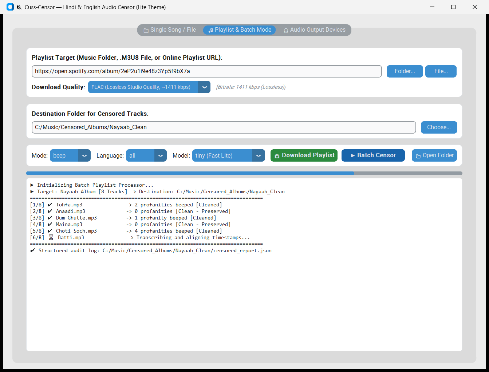
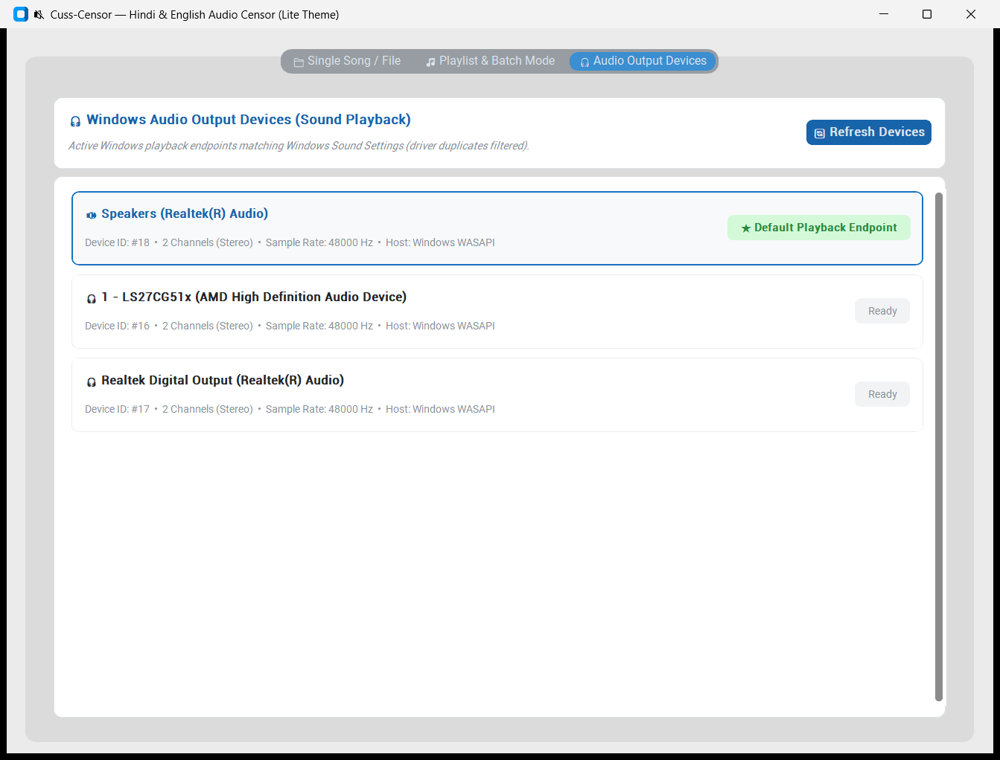

# 🔇 Cuss-Censor

> **Automated Multilingual Audio & Video Profanity Censoring for Hindi, English, and Hinglish.**

[](https://www.python.org/downloads/)
[](LICENSE)
[](https://github.com/TomSchimansky/CustomTkinter)
[](https://github.com/openai/whisper)
[](https://ffmpeg.org/)

---

## 📖 Overview

**Cuss-Censor** is a high-performance audio and video censoring suite built to detect and censor profanities, slurs, and gaalis across **Hindi (Devanagari)**, **Romanized Hindi / Hinglish**, and **English**.

It employs a hybrid transcription pipeline:
1. **YouTube Description & Synced Lyrics Resolution (.LRC)**: Automatically scans YouTube video descriptions for timestamped lyrics (`0:15 ...`), section markers, or `Lyrics:` blocks, or queries synced lyric repositories (LRCLIB, Musixmatch, NetEase) using `Song Name + Artist`. If matched, word timestamps are resolved instantly (~0.2s) with zero transcription wait time.
2. **OpenAI Whisper Speech Recognition**: For unlisted songs, podcasts, videos, or local voice tracks without available lyrics, the system falls back seamlessly to offline **OpenAI Whisper** models (`tiny`, `base`, `small`, `medium`) with vocabulary priming for Desi hip-hop and slang.
3. **FFmpeg Censoring Engine**: Injects customizable 1000 Hz beep tones or silent mutes with phoneme-level padding while preserving video streams via lossless stream copying (`-c:v copy`).

---

## 🚀 Key Features

* **Complete Censoring Workflows**:
  * **📁 Single Song / File Mode**: Censor local files or download directly from URLs (Spotify, YouTube, JioSaavn, SoundCloud) with explicit audio quality presets.
  * **🎵 Playlist & Batch Mode**: Batch-process entire directories of songs, M3U8/HLS playlists, or remote albums. Generates clean audio/video files alongside a structured JSON audit report (`censored_report.json`).
  * **🎧 Clean Windows Playback Devices**: Native Windows Sound Settings monitor displaying only active playback endpoints (`Speakers`, `Headphones`, `HDMI/DP`, `Digital Output`) and default endpoint tagging, eliminating raw driver clones.
* **⚡ Precision Zero-Lag Synchronization & Calibration**:
  * **Active Vocal Tempo Modeling**: Smart word interpolation dynamically models vocal speech duration instead of stretching across silence, eliminating lyric drift on beats.
  * **Asymmetric Pre-Padding**: 250ms lead-in padding catches the onset consonants of profane words before sound leaks.
  * **Sync Shift Calibration**: User-configurable offset (`-0.5s Earlier`, `-0.3s`, `+0.3s`) in both GUI and CLI perfectly compensates for YouTube intro logos, stream delays, or platform discrepancies.
* **Multilingual Slang & Profanity Engine**:
  * **English**: Common curse words, slurs, and leetspeak variations (`f**k`, `sh*t`, `b*tch`, etc.).
  * **Hindi (Devanagari)**: `म****चोद`, `ब***चोद`, `भो***के`, `चू***या`, `ल**ड़ा`, `गां*ू`, `रं*ी`, `ह***मी`, etc.
  * **Romanized Hindi & Hinglish**: `m*`, `b*`, `b*l`, `bs*k`, `ch*tiya`, `m*darchod`, `b*henchod`, `h*rami`, `g*andu`, `t*ri m** ki`, `bh*n ke l*de`, etc.
  * **Phrase Matching**: Accurately detects multi-word abusive phrases with interval merging and phoneme padding (0.10s - 0.15s).
* **High-Quality Audio Downloader**:
  * Download single tracks or full playlists directly in FLAC Lossless (1411 kbps), MP3 320 kbps, AAC 256 kbps, or Native Opus.
* **Lossless Video Preservation**:
  * Preserves video frames untouched using FFmpeg stream copying without re-encoding video streams.
* **Reverse Engineering with REA**:
  * Integrates **[REA (Reverse Engineer Anything)](https://github.com/morluto/rea)** to probe unknown desktop binaries, Electron audio decoders, and network stream protocols (`rea-probe`).

---

## 🛠️ Architecture

```
[Media Input: File / Folder / Playlist URL]
                      │
        ┌─────────────┴─────────────┐
        ▼                           ▼
[REA Format Inspector]      [High-Quality Audio Downloader]
        │                           │
        └─────────────┬─────────────┘
                      ▼
[Online Synced Lyrics Provider (Song + Artist)]
      │ (Match found: 0.2s)         │ (Not found: Fallback)
      ▼                             ▼
[Word Timestamp Aligner]    [OpenAI Whisper Engine]
      │                             │
      └──────────────┬──────────────┘
                     ▼
        [Profanity Detector & DB]
    (English + Hindi Devanagari + Romanized)
                     │
                     ▼
             [Interval Merger]
                     │
        ┌────────────┴────────────┐
        ▼                         ▼
  [Beep Injector]          [Mute Attenuator]
   (1000 Hz Tone)           (Zero Fill)
        │                         │
        └────────────┬────────────┘
                     ▼
       [Output: Clean Media Files]
```

---

## 📦 Installation

### Prerequisites
* **Python 3.10+**
* **FFmpeg** installed and added to system `PATH`
* **Node.js 22+** (optional, required only for REA protocol probe)

### Setup

```bash
# Clone the repository
git clone https://github.com/JIYAAD-GldTON/Music-censor-and-download.git
cd Music-censor-and-download

# Install dependencies
pip install -r requirements.txt
```

---

## 🖥️ Desktop GUI (Lite Theme)

Launch the desktop interface:
```bash
python censor.py gui
```
*On Windows, you can also double-click `launch_gui.bat`.*

### Clean 3-Tab Interface:
* **☀️ Full-Fidelity Lite Theme**: Built with crisp typography and light styling (`#f8f9fa` header, `#ffffff` card backgrounds, `#1864ab` accents), with an integrated theme switcher.
* **📁 Single Song / File Tab (With Built-in Downloader)**:
  * **Option A**: Browse local audio or video files.
  * **Option B**: Paste a track URL (Spotify, YouTube, JioSaavn, SoundCloud) -> Select explicit audio quality -> Click **"📥 Download Song"**. The file is fetched, metadata extracted, and populated ready for censoring.
  * **🔍 Find Lyrics**: Queries online databases and displays real-time lyrics with swear word annotations.
  * **⏱️ Sync Shift Dropdown**: Instant timing calibration (`-0.5s (Fix Lag)`, `-0.3s Earlier`, `+0.3s Later`) to align beeps precisely with speech.
* **🎵 Playlist & Batch Mode Tab**:
  * Download full albums and playlists with explicit audio quality presets.
  * Batch censor tracks in parallel, calibrate sync timing, view real-time progress bars, and inspect the JSON report.
* **🎧 Audio Output Devices Tab**:
  * Lists clean, active Windows playback output endpoints (`Speakers`, `Headphones`, `HDMI/DP`, `Digital Output`) matching Windows Sound Settings, with default device tagging.

---

### 📸 Application Screenshots

#### 1. Single Song Censoring & Direct URL Downloader (Seedhe Maut — Nanchaku)


#### 2. Playlist & Batch Mode Processor (Album Batch with Audit Log)


#### 3. Windows Audio Playback Devices Inspector (Clean Output Endpoints)


---

## 🎚️ Explicit Audio Download Qualities

When downloading tracks or playlists, select from explicit quality presets:

| Quality Preset | Bitrate / Format | Description |
|---|---|---|
| **FLAC** | `~1411 kbps` | Lossless studio master. Bit-perfect fidelity. |
| **MP3 320k** | `320 kbps (CBR/VBR0)` | Extreme quality. Punchy bass & crisp highs. |
| **AAC 256k** | `256 kbps (M4A)` | High-efficiency Apple / YouTube standard. |
| **Opus** | `160 kbps (Native)` | Untouched original stream from server with 0 re-encoding loss. |
| **WAV** | `1411 kbps` | Raw uncompressed PCM audio. |
| **MP3 192k** | `192 kbps` | Balanced standard quality with smaller file sizes. |

---

## 💻 CLI Usage

### 1. View Audio Playback Devices
```bash
python censor.py devices
```

### 2. Download Songs or Playlists
```bash
# Download a single track in 320 kbps MP3
python censor.py download --url "https://www.youtube.com/watch?v=..." --quality mp3_320 --single

# Download an entire playlist in Lossless FLAC
python censor.py download --url "https://www.youtube.com/playlist?list=..." --quality flac --playlist
```

### 3. Censor a Single File
```bash
# Censor with Song Name and Artist hint (queries synced lyrics first)
python censor.py file --input "Nanchaku.mp3" --song "Nanchaku" --artist "Seedhe Maut" --mode beep

# Censor using YouTube description lyrics & timestamps directly
python censor.py file --input song.mp3 --desc "https://www.youtube.com/watch?v=..." --mode beep

# Fix 0.5s audio lag / intro delay with timing calibration offset (-0.5s earlier)
python censor.py file --input song.mp3 --mode beep --offset -0.5

# Censor with beep sound using Whisper speech-to-text
python censor.py file --input song.mp3 --mode beep --model base

# Censor with mute silence
python censor.py file --input video.mp4 --mode mute --output video_clean.mp4
```

### 4. Batch-Censor a Folder or Playlist
```bash
# Batch censor with timing calibration
python censor.py playlist --input ./my_songs/ --output-dir ./censored_songs --mode beep --lang all --offset -0.5
```
*Outputs clean files and generates `censored_report.json` with timestamped logs of every flagged word.*

### 5. Probe Unknown Protocols with REA
```bash
python censor.py rea-probe --target "https://example.com/live/stream.m3u8"
```

---

## 📁 Repository Structure

```text
cuss-censor/
├── censor.py                # Main CLI entry point
├── downloader.py            # High-quality audio & playlist downloader
├── launch_gui.bat           # Windows 1-click launcher
├── requirements.txt         # Python package dependencies
├── LICENSE                  # MIT License
├── README.md                # Documentation
├── core/
│   ├── asr/                 # Speech recognition & lyrics engine
│   │   ├── lyrics_provider.py   # Online & local synced lyrics (.LRC) parser
│   │   └── whisper_engine.py    # OpenAI Whisper wrapper with slang vocabulary
│   ├── censor/              # Audio & video modification engine
│   │   ├── beep.py              # Tone synthesis and mute segment generator
│   │   └── ffmpeg_censor.py     # FFmpeg media segment splicer
│   ├── devices.py           # Clean Windows audio playback device inspector
│   ├── filter/              # Profanity detection engine
│   │   ├── detector.py          # Word timestamp profanity detector
│   │   └── profanity_db.py      # Multilingual profanity dictionaries
│   └── rea/                 # Reverse Engineer Anything (REA) integration
│       ├── format_inspector.py  # Media format & stream manifest inspector
│       └── protocol_probe.py    # Stream protocol & application analyzer
├── data/
│   └── wordlists/           # Multilingual word lists
│       ├── english_cuss.txt     # English profanities
│       ├── hindi_devanagari.txt # Hindi (Devanagari script) gaalis
│       └── hindi_roman.txt      # Romanized Hindi & Hinglish slang
├── modes/
│   └── playlist_mode.py     # Batch folder and playlist processing runner
├── tests/
│   ├── test_detector.py     # Unit tests for profanity engine
│   └── test_devices.py      # Unit tests for device filtering & deduplication
├── downloads/               # Target folder for downloaded songs
└── censored_output/         # Target folder for exported clean media
```

---

## 🧪 Testing

Run automated unit tests:
```bash
python -m unittest discover -s tests
```

---

## 📄 License

This project is licensed under the MIT License - see the [LICENSE](LICENSE) file for details.
